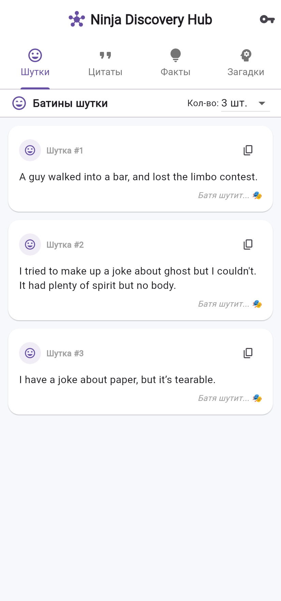
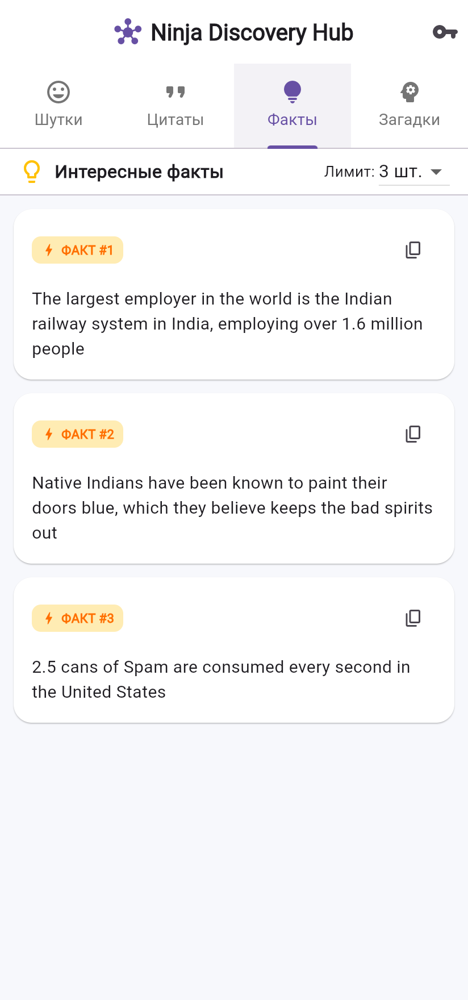
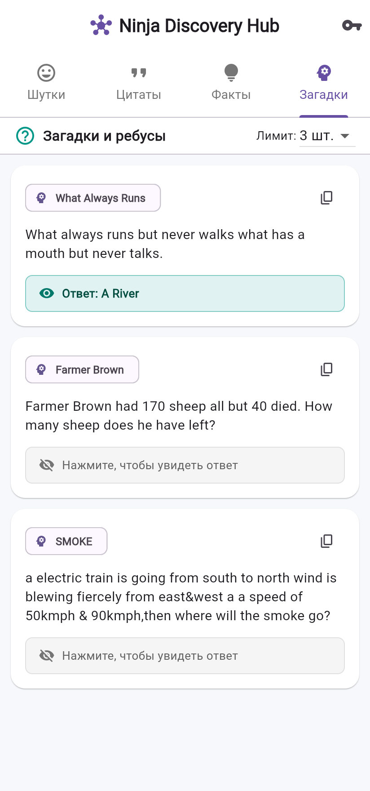
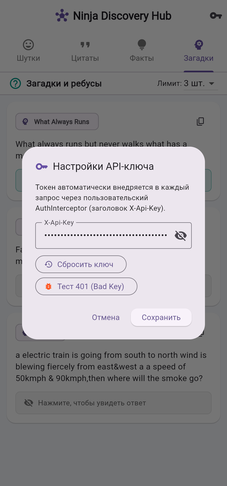

# Практическая работа №4: Работа с сетью через Dio, Interceptors и GetIt во Flutter

Учебный проект по дисциплине «Разработка мобильных приложений» (темы: сетевой клиент `Dio`, пользовательские перехватчики `AuthInterceptor` и `LoggingInterceptor`, форматированная телеметрия `PrettyDioLogger`, сервис-локатор `GetIt` и интеграция с REST API [API Ninjas](https://api-ninjas.com)).

---

## 1. О проекте
Приложение **«Ninja Discovery Hub»** представляет собой мобильный клиент для работы с внешними REST API-сервисами, спроектированный в соответствии с чистой архитектурой (Clean Architecture) и лекционными стандартами курса:

- **Архитектура и DI (`GetIt`)**:
  - `TokenManager` — синглтон динамического управления runtime-токеном API.
  - `Dio` — централизованный HTTP-клиент с преднастроенными таймаутами (`connectTimeout`, `receiveTimeout`) и цепочкой перехватчиков.
  - `NinjasApiService` — изолированный слой бизнес-логики и выполнения запросов с обработкой `DioException`.
- **Сетевые перехватчики (Interceptors)**:
  - `AuthInterceptor` (`onRequest` / `onError`) — автоматически подставляет актуальный ключ в заголовок `X-Api-Key` каждого исходящего запроса.
  - `LoggingInterceptor` — перехватчик для отслеживания жизненного цикла запросов.
  - `PrettyDioLogger` — красивый форматированный вывод заголовков, тел запросов/ответов и статус-кодов в консоль разработчика.

---

## 2. Реализованный функционал

### На оценку «4»:
1. **Сетевой клиент на базе пакета Dio**:
   - Асинхронные HTTP GET-запросы с валидацией статус-кодов и десериализацией JSON в типизированные DTO-модели.
2. **Централизованный `AuthInterceptor`**:
   - Автоматическая инъекция авторизационного заголовка `X-Api-Key` без ручного дублирования в сервисах.
3. **Логирование через `PrettyDioLogger`**:
   - Полная телеметрия сетевого взаимодействия с подсветкой синтаксиса в терминале.

### На оценку «5»:
1. **Внедрение зависимостей через Service Locator `GetIt`**:
   - Регистрация зависимостей как Lazy Singletons (`TokenManager`, `Dio`, `NinjasApiService`).
2. **Развитый многомодульный интерфейс**:
   - **Шутки (Dad Jokes)**: эндпоинт `/v1/dadjokes` с выбором количества, быстрым копированием в буфер обмена и карточками.
   - **Цитаты (Quotes)**: эндпоинт `/v1/quotes` с отображением цитат великих людей, автора и тематических тегов.
   - **Факты (Facts)**: эндпоинт `/v1/facts` с интересными историческими и научными фактами.
   - **Загадки со спойлерами (Riddles)**: эндпоинт `/v1/riddles` с интерактивным раскрытием ответов по нажатию (спойлер).
3. **Панель управления токеном и сетевой диагностикой**:
   - Диалог динамической смены токена, маскировка ввода, сброс к токену по умолчанию и симуляция ошибки `401 Unauthorized`.

---

## 3. Скриншоты работы приложения

<div align="center">

### 1. Раздел «Шутки» (Успешный сетевой запрос Dad Jokes)
*Отображение полученных через Dio шуток с бейджами и копированием в буфер*
<br><br>


<br><br>
---
<br>

### 2. Раздел «Цитаты» (Эндпоинт Quotes)
*Подгрузка цитат известных личностей с фильтрацией по категориям*
<br><br>


<br><br>
---
<br>

### 3. Раздел «Факты» (Эндпоинт Facts)
*Познавательные факты с обновлением списка*
<br><br>


<br><br>
---
<br>

### 4. Раздел «Загадки» (Интерактивный спойлер ответа)
*Загадки с динамическим раскрытием правильного ответа по клику*
<br><br>


<br><br>
---
<br>

### 5. Окно настроек API-токена и AuthInterceptor
*Управление ключом в TokenManager, маскировка и симуляция 401 Unauthorized*
<br><br>


</div>

---

## 4. Запуск проекта

```bash
# Установка зависимостей
flutter pub get

# Запуск приложения
flutter run
```
